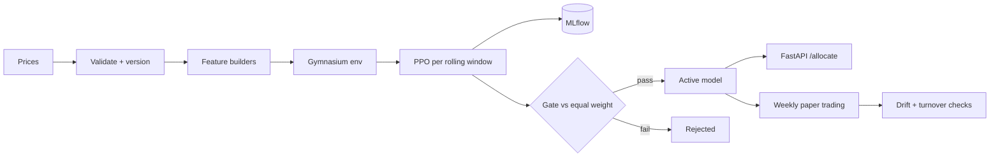

# rl-etf-allocation

[](https://github.com/mennosmit-dev/rl-etf-allocation/actions/workflows/ci.yml)

Can a reinforcement learning agent allocate a long-horizon ETF portfolio better than holding every ETF in equal weight?

## Result

In my MSc thesis (Quantitative Finance, Erasmus School of Economics, 2026) a PPO agent was trained and evaluated in a rolling out-of-sample setup on weekly returns of US-listed ETFs, net of transaction costs, from March 2017 to August 2025. Against the equally weighted portfolio (1/N, a benchmark known to be hard to beat) it reported:

| Metric (out of sample) | Equal weight | PPO minus equal weight |
| --- | --- | --- |
| CAGR (%) | 6.74 | +1.89 |
| Sharpe ratio | 0.45 | +0.11 |
| Sortino ratio | 0.64 | +0.21 |
| Calmar ratio | 0.30 | +0.06 |
| Max drawdown (%) | 22.25 | +1.82 (worse) |

Reported in MSc thesis; tuned configuration is private. None of these differences is significant at the 5% level under a paired block bootstrap, so read them as a direction, not as proof. The defaults in this repository are placeholders and will not reproduce these numbers.

## How it fits together



Prices are validated with a pandera schema and the weekly return dataset is versioned by content hash. Each rolling window trains a fresh PPO agent (stable-baselines3) and scores it on the next, unseen window against equal weight. Every run is logged to MLflow. A model only becomes active after it passes the evaluation gate in the registry, and serving and paper trading only load the active model. More detail, including the AWS deployment, is in [docs/architecture.md](docs/architecture.md).

## Quickstart

```bash
uv sync
uv run rl-etf train --config configs/example.yaml
uv run pytest
```

The example config uses synthetic prices, so it runs offline in under a minute. Other commands: `rl-etf data`, `retrain` (walk-forward), `promote`, `rollback`, `paper`, `monitor` and `serve`. Public prices are available with `uv sync --extra fetch` and `data.source: yfinance`. No data is committed.

## Design decisions

**Softmax over logits for the weights.** The policy outputs one unbounded number per ETF and the environment maps them to long-only weights with a softmax. I rejected clipping raw actions and renormalising, because clipped actions give the policy no gradient at the bounds and the weights can still sum to zero. A Dirichlet policy was the other option, but the softmax keeps the standard stable-baselines3 Gaussian policy unchanged.

**Walk-forward retraining with fixed-length windows.** Every window trains on the same number of weeks and is evaluated on the weeks right after it, and the validation periods are stitched into one out-of-sample series. I rejected a single train/test split because it gives one noisy number, and an expanding window because old regimes then dominate later models and the windows are hard to compare.

**No look-ahead by construction.** A feature builder may only use returns up to week t, and the environment shows the agent the features of week t-1 when it picks the weights for week t. I rejected leaving the lag to each feature, since one forgotten shift silently inflates every backtest. A test changes future returns and checks that no earlier feature moves.

**A small file-based registry with an explicit gate.** Candidates and the active pointer are JSON files, and every promotion or rollback is appended to a history file. I considered the MLflow Model Registry, but I wanted promotion to be a reviewable diff and the paper trader to run without a tracking server. MLflow still records every run, and each registry entry stores its run id and dataset hash.

**A human in the loop for large reallocations.** When a proposed rebalance exceeds a turnover limit it is held until approved. I rejected fully automatic execution: a policy can swing abruptly after a retrain, and a missed rebalance costs far less than an unwanted one.

## What is private

The tuned hyperparameters, the feature set, the reward function, the dynamic portfolio sizing, the ETF universe and everything tied to a broker account are not in this repository. The strategy is work I may still build on, and the account details are a security risk. Each of them sits behind an interface here (`features/`, `envs/reward.py`, `envs/sizing.py`, `paper/broker.py`) with a simple, documented default, so the engineering is complete and runnable while the strategy stays private.

## Limitations

- The thesis gains are economically meaningful but not statistically significant for standard PPO, and the thesis notes signs of overfitting.
- The defaults run on synthetic data. Numbers from the quickstart say nothing about real markets.
- The simulated broker fills at the last weekly close with a proportional cost: no slippage model, no taxes, no partial fills.
- Weekly frequency and long-only weights only.
- The template in `infra/` is a reduced reference and is not deployed from this repository.

## Status

The private version runs weekly on AWS ECS Fargate: a precheck, a manual approval step before any order, execution and twice-yearly retraining. This repository is educational and is not financial advice.
