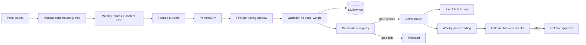
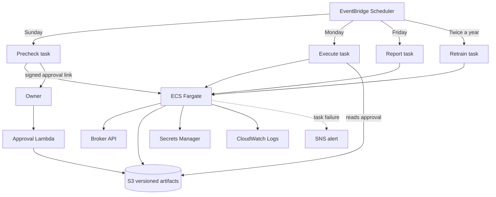

# Architecture

This document describes how the code in this repository fits together and how
the same code runs as scheduled jobs on AWS. The deployment
details that would identify accounts, buckets or credentials are left out.

## Code layout

```
src/rl_portfolio/
  data/        price sources, schema validation, versioned weekly return dataset
  features/    pluggable feature builders (registry + three standard examples)
  envs/        Gymnasium environment, reward interface, portfolio sizing interface
  training/    PPO training per window, walk-forward retraining, backtests
  tracking.py  MLflow wrapper (params, metrics, model artifact, dataset hash tag)
  registry.py  candidate/active model registry, evaluation gate, rollback
  serving/     model loading and the FastAPI allocation service
  paper/       broker interface, simulated broker, rebalance planning, weekly loop
  monitoring/  feature drift (PSI) and turnover checks
  cli.py       one entry point, one subcommand per scheduled job
```

## Model lifecycle



1. `rl-etf data` loads prices, validates them with a pandera schema plus
   checks for ordering, length and implausible weekly moves, and writes weekly
   returns with a metadata file holding a content hash. Every later step
   records that hash, so a model can always be traced to the exact data.
2. `rl-etf retrain` rolls a fixed-length training window forward. For each
   window it trains PPO, then scores the policy on the following validation
   window, starting from the weights the policy held at the end of training.
   The validation windows are stitched into one out-of-sample series.
3. The model from the last window is registered as a candidate. Promotion runs
   the evaluation gate: the model file must exist, the validation Sharpe ratio
   must beat equal weight by a configurable margin, and the drawdown may not be
   much worse than equal weight. Promotions and rollbacks are appended to a
   history file.
4. Serving and paper trading only ever load the active model.

## Scheduled jobs on AWS

The private version runs the same package as one container image with
several scheduled entry points.



- The Sunday precheck refreshes data, computes the proposed allocation, runs
  the drift and order checks and sends a summary with a signed, expiring
  approval link. It never submits orders.
- The Monday task reprices at execution time, re-runs the checks, and only
  submits orders when an unexpired approval for that exact allocation
  exists. Weekend prices are never trusted for execution.
- A lock prevents two overlapping runs from trading the same week twice.
- Retraining produces a candidate. Promotion stays a separate, logged step.
- Credentials live in Secrets Manager and reach the container as environment
  variables. Nothing secret is written to logs or artifacts.

`infra/cloudformation/paper-trading.example.yaml` is a reduced, parameterised
version of the stack for reference. It is not deployed from this repository.
